# loteria_push

A new Flutter project.

## Getting Started

This project is a starting point for a Flutter application.

A few resources to get you started if this is your first Flutter project:

- [Learn Flutter](https://docs.flutter.dev/get-started/learn-flutter)
- [Write your first Flutter app](https://docs.flutter.dev/get-started/codelab)
- [Flutter learning resources](https://docs.flutter.dev/reference/learning-resources)

For help getting started with Flutter development, view the
[online documentation](https://docs.flutter.dev/), which offers tutorials,
samples, guidance on mobile development, and a full API reference.

## Ronda 1. Preparar Firebase, Android e iOS
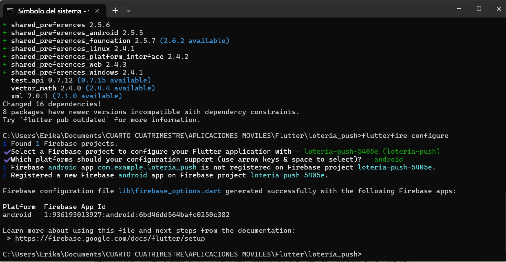

## Ronda 2. El servidor primero: la baraja y las reglas (TDD en Node)
### ROJO
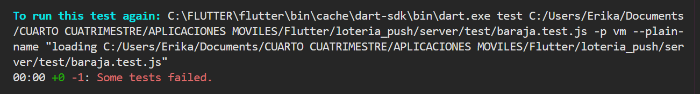

### VERDE
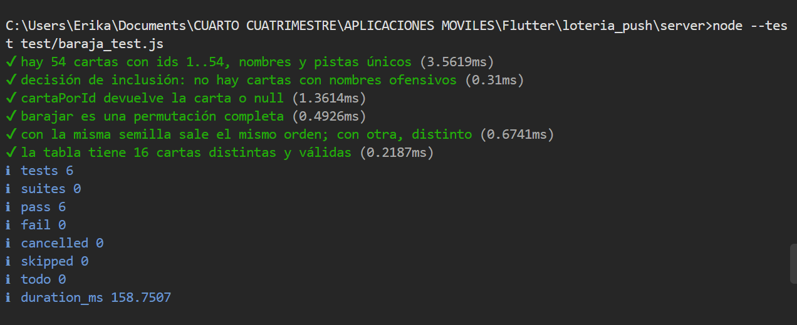

## Líneas ganadoras
### ROJO
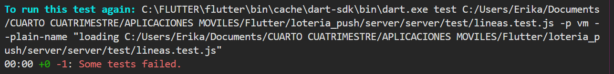

### VERDE
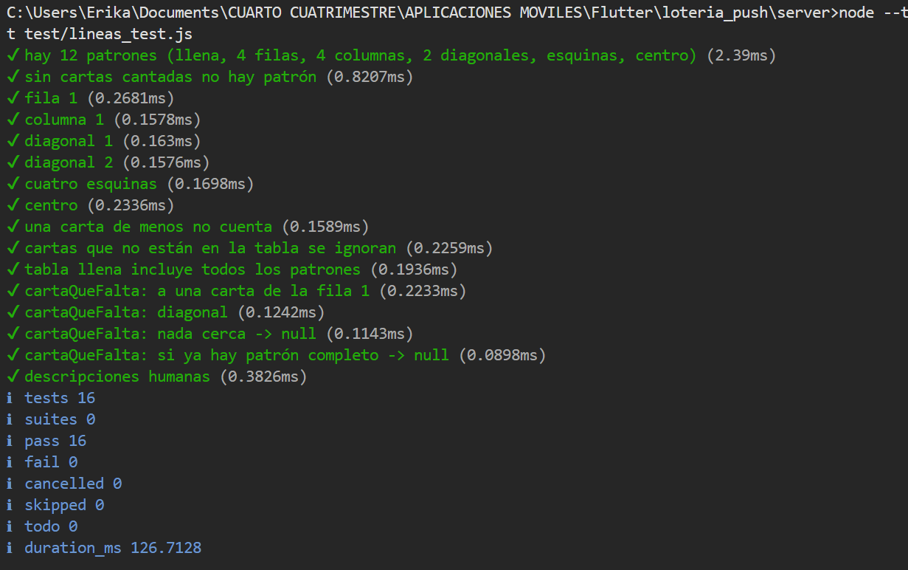

## Ronda 3. Armar mensajes push correctos
### ROJO
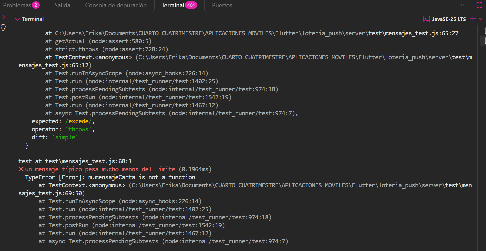

### VERDE
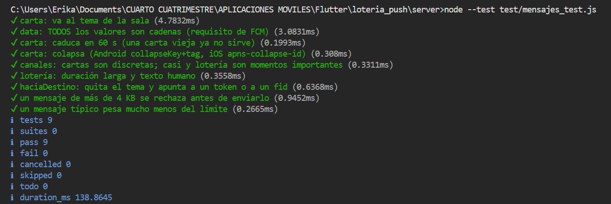

## Ronda 4. La sala: reglas, autorización y trampas
### ROJO
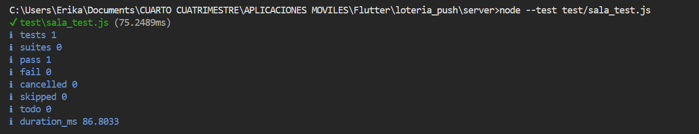

### VERDE
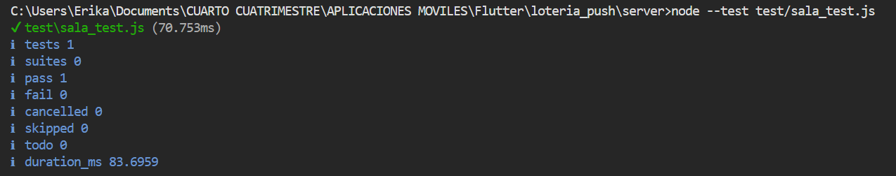

## Ronda 5. El servidor HTTP y el envío seguro
### ROJO
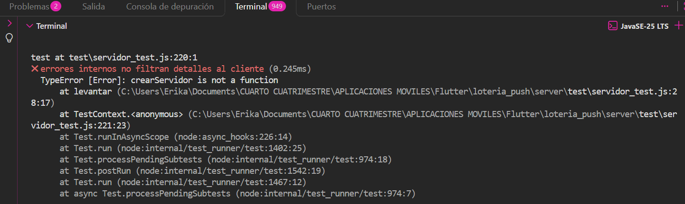

### VERDE
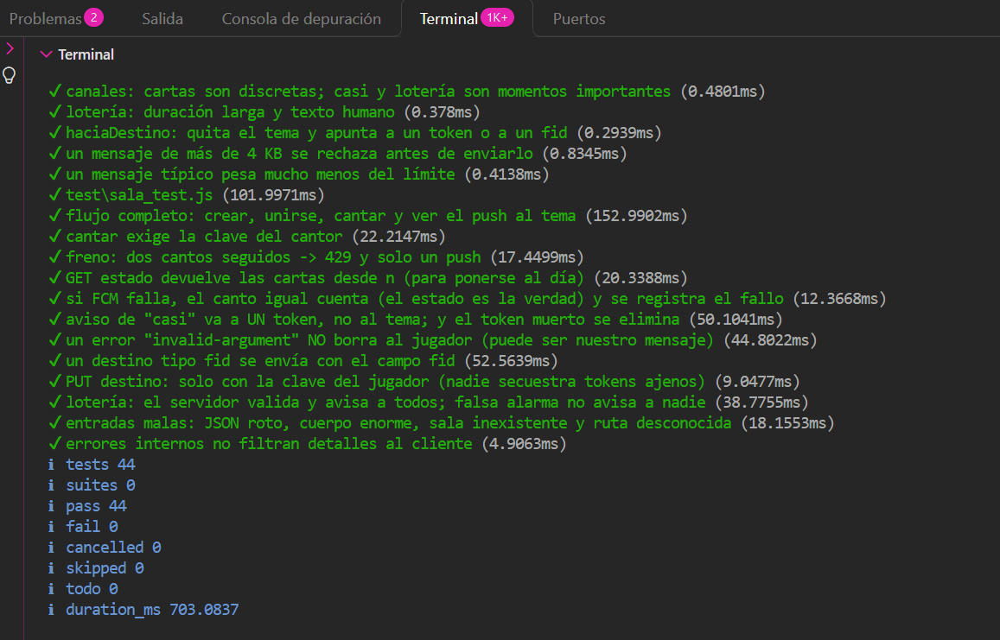

## Ronda 6. La app: parsear lo que llega y mantener la partida
### ROJO
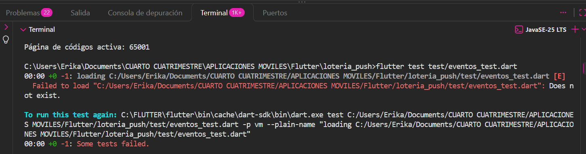

### VERDE
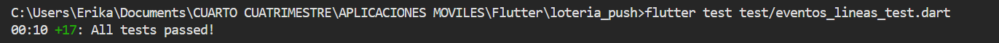

## La partida: idempotente y consciente de huecos
### ROJO
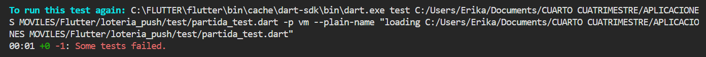

### VERDE
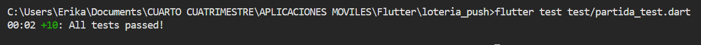

## Ronda 7. Puertos, doble de pruebas y el controlador
### ROJO
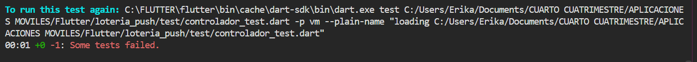

### VERDE
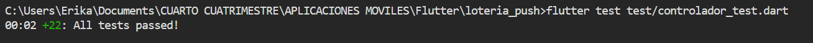

## Ronda 8. El adaptador de Firebase: tres estados de la app
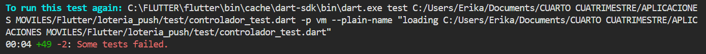

## Ronda 9. Pantallas, ViewModels y el arranque
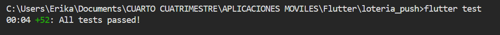